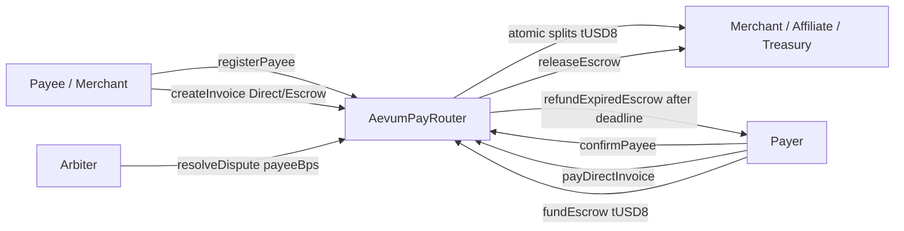

# AevumPay — Verifiable Stablecoin Invoice, Confirmation-of-Payee & Split Escrow Router

Built for **Aevum Builder Challenge #1** on DoraHacks (`https://dorahacks.io/hackathon/qday`).

## Problem

Stablecoin payments on EVM chains suffer from three practical gaps for merchants and B2B/freelance workflows:
1. **Misdirected transfers (no Confirmation of Payee):** Payers copy-paste raw `0x...` addresses with no on-chain identity binding.
2. **All-or-nothing custody risk:** Direct transfers have no milestone protection or time-locked refund if a counterparty ghosts, while manual multisigs add friction.
3. **Multi-party settlement overhead:** Splitting revenue (merchant + affiliate/referrer + tax/treasury) requires multiple transactions and extra gas.

## Solution

`AevumPayRouter` delivers one cohesive, end-to-end **tUSD8** payment flow on **Aevum Testnet**:
- **On-Chain Confirmation of Payee (CoP):** Payees register unique handles (`registerPayee(handle, metadataHash)`). Invoices can enforce `expectedPayeeHandleHash` at both creation and settlement—if the payee deactivates or mismatches, payment reverts.
- **Direct & Escrowed Modes:**
  - `Direct`: Atomic `tUSD8` settlement with up to 5 configurable basis-point splits (`MAX_BPS = 10_000`).
  - `Escrow`: Payer funds `tUSD8` into the router; payer or arbiter releases to splits on delivery, payer self-refunds after `deadline` (`refundExpiredEscrow`), or `arbiter` resolves disputes (`resolveDispute(invoiceId, payeeBps)`).
- **Scoped Agentic Session Keys & ERC-8004 Guardrails (`AgentSessionModule`):**
  - Owners/smart accounts grant a scoped `sessionKey` via `createAgentSession` with `maxPerTxAmount`, cumulative `totalBudget`, strict `expiresAt`, optional `allowedPayee` pinning (`address(0)` enforces active CoP verification on every payee), and an ERC-8004-compatible `agentId` + optional `IERC8004IdentityRegistry.ownerOf(agentId)` hook.
  - Agents execute payments via `payDirectWithSession(sessionId, invoiceId)` and `fundEscrowWithSession(sessionId, invoiceId)` against the owner's pre-approved `tUSD8` allowance; `fundedBy` is attributed to the owner so escrow refunds and dispute rights remain with the principal.
  - Owners can instantly kill a compromised or runaway agent key with `revokeAgentSession(sessionId)`.
- **ERC-20 & EIP-2612 Support:** Standard `approve` + `transferFrom` for Aevum's `tUSD8` (`0x456569838f1d43009A91ebA4263147Afd7233483`, 6 decimals), plus `*WithPermit` variants for EIP-2612 tokens.

## Architecture



## Verified Aevum Testnet Configuration

| Parameter | Value |
|---|---|
| Network Name | QDay Aevum Testnet |
| Chain ID | `44005` (`0xabe5`) |
| RPC URL | `https://rpc-test.qday.info` |
| Native Gas Token | `tQDAY` (18 decimals) |
| Test Stablecoin (`tUSD8`) | `0x456569838f1d43009A91ebA4263147Afd7233483` (6 decimals) |
| Block Explorer | `https://explorer-test.qday.info` |
| Faucet | `https://faucet.qday.info/en` |
| Live Deployed `AevumPayRouter` | [`0x2AfEEC24f2a810D726DB47CAEa3A76AaF6A7D50E`](https://explorer-test.qday.info/address/0x2AfEEC24f2a810D726DB47CAEa3A76AaF6A7D50E) (Block `3300314`, Deploy Tx: [`0xb71451a2...5dc4bd1`](https://explorer-test.qday.info/tx/0xb71451a2dc4b4c0329d25133de4c6659920389ecc4087f0f8c870b26b5dc4bd1)) |

## Quickstart

### 1. Run Foundry Tests

```bash
forge test -vvv
```

### 2. Check Live Aevum Testnet, Balances & Agent Sessions (Python CLI)

```bash
python cli/aevum_pay_cli.py status
python cli/aevum_pay_cli.py balance 0xYOUR_ADDRESS
python cli/aevum_pay_cli.py session inspect 0xROUTER_ADDRESS --session-id 0xSESSION_ID
python cli/aevum_pay_cli.py session revoke 0xROUTER_ADDRESS --session-id 0xSESSION_ID
```

### 3. Deploy to Aevum Testnet

1. Claim `tQDAY` (gas) and `tUSD8` from `https://faucet.qday.info/en`.
2. Deploy `AevumPayRouter`:

```bash
forge script script/DeployAevumPay.s.sol:DeployAevumPay \
  --rpc-url https://rpc-test.qday.info \
  --private-key $PRIVATE_KEY \
  --broadcast
```

### 4. Interactive Prototype UI

Open `frontend/index.html` in a browser (or serve locally with `python -m http.server 8080 --directory frontend`), click **Connect & Switch to Aevum Testnet**, paste your deployed `AevumPayRouter` address, and run the full Register -> Confirm Payee -> Create Invoice -> Approve `tUSD8` -> Pay / Fund / Release / Refund flow.

## Security & Controls

- **Reentrancy protection:** Explicit `nonReentrant` lock on all token-moving functions.
- **SafeERC20:** Handles both standard boolean-returning and void-returning ERC-20s.
- **No stuck escrow funds:** `refundExpiredEscrow` is permissionless after `deadline` and always returns `100%` to `fundedBy`.
- **Bounded splits:** Capped at `MAX_SPLITS = 5` with exact `10_000` bps sum validation and deterministic dust assignment to `splits[0]`.
- **Fuzz-tested:** `testFuzz_TokenConservationAcrossDisputeSplits` verifies zero token loss/leakage across arbitrary amounts, split ratios, and dispute outcomes; `testFuzz_AgentSessionSpendCapAndExpiry` verifies per-tx caps, cumulative budget enforcement, and timestamp expiry across arbitrary inputs.
- **Least-privilege agent controls:** Session keys cannot exceed `maxPerTxAmount` or `totalBudget`, cannot pay unverified payees when `allowedPayee == address(0)`, re-verify ERC-8004 ownership on every execution when `agentRegistry != address(0)`, and can be halted immediately via `revokeAgentSession`.
